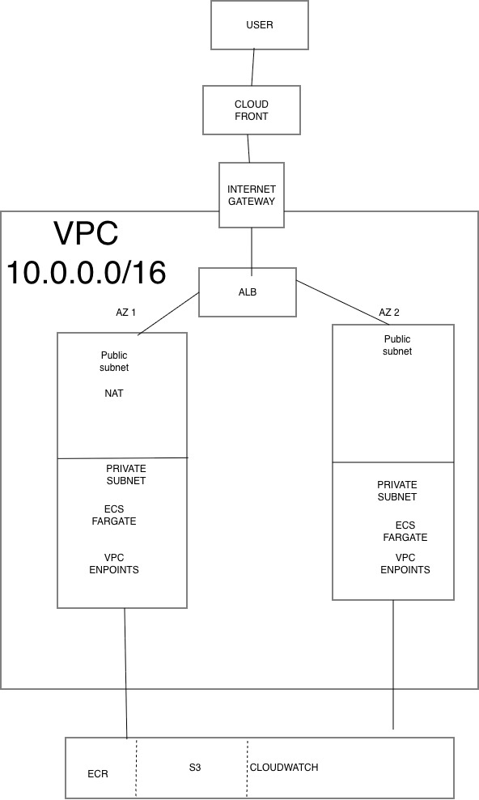

# AWS ECS Fargate — Multi-AZ Containerized App on Terraform

A production-shape AWS deployment: containerized Flask app running on ECS Fargate across two Availability Zones, fronted by an Application Load Balancer and CloudFront for HTTPS + global edge caching. Entirely provisioned via Terraform.

## Architecture



**Traffic flow:**
`User → CloudFront (HTTPS, edge cache) → ALB (public subnets, HTTP) → Fargate task (private subnet) → "ok"`

**Egress flow (container pulling image, writing logs):**
`Fargate task (private subnet) → VPC Endpoint → ECR / CloudWatch Logs` (no NAT traversal, no internet exposure)

## Components

| Layer | Service | Purpose |
|---|---|---|
| Edge | CloudFront | HTTPS termination, global caching, HTTP→HTTPS redirect |
| Load balancing | Application Load Balancer | Routes traffic to healthy Fargate tasks |
| Compute | ECS Fargate | Runs 2 containers across 2 AZs (256 CPU / 512 MB) |
| Registry | ECR | Private container image storage with lifecycle policy (keep last 5) |
| Networking | VPC (10.0.0.0/16) | 2 public + 2 private subnets across us-east-1a and us-east-1b |
| Egress | NAT Gateway | Single NAT for private subnet outbound to non-AWS services |
| Private connectivity | VPC Endpoints (S3, ECR API, ECR DKR, CloudWatch Logs) | Fargate reaches AWS services without internet traversal |
| Security | IAM (split roles), Security Groups | Least-privilege access; SG chaining between ALB and app tier |
| Observability | CloudWatch Logs | Container logs with 7-day retention |

## Design decisions

- **Multi-AZ**: 2 AZs for AZ-failure resilience. ALB automatically routes around a failed AZ.
- **Private subnets for compute**: Fargate tasks have no public IPs. Only the ALB is internet-facing.
- **Split IAM roles**: `execution_role` (used by ECS agent to pull images and write logs) is separate from `task_role` (assumed by the app itself). Enforces least privilege — a compromised container inherits only task-level permissions.
- **VPC Endpoints**: S3 gateway endpoint (free) plus interface endpoints for ECR (API + DKR) and CloudWatch Logs. Eliminates NAT data-processing charges for AWS-service traffic and keeps that traffic on AWS's private network.
- **Single NAT vs per-AZ**: Chose single NAT (~\$32/month) over one-per-AZ (~\$64/month) for cost. Trade-off: if AZ-1 fails, AZ-2's private subnet loses outbound to non-AWS services. Acceptable for a portfolio project; per-AZ is the production pattern.
- **CloudFront PriceClass_100**: North America + Europe only. Matches target audience and cuts edge-serving costs.
- **CloudFront → ALB over HTTP**: CloudFront terminates HTTPS at the edge; origin traffic stays inside AWS's network. Full end-to-end TLS would require ACM + a custom domain on the ALB (future work).

## Reproducing this from zero

Prerequisites:
- AWS account with CLI credentials configured
- Terraform ≥ 1.5
- Docker Desktop
- AWS CLI v2

Deploy:
```bash
cd terraform
terraform init
terraform apply
```

Push the container image:
```bash
cd ../app
aws ecr get-login-password --region us-east-1 | docker login --username AWS --password-stdin <ACCOUNT_ID>.dkr.ecr.us-east-1.amazonaws.com
docker buildx build --platform linux/amd64 -t rada-app --load .
docker tag rada-app:latest <ACCOUNT_ID>.dkr.ecr.us-east-1.amazonaws.com/rada-app:latest
docker push <ACCOUNT_ID>.dkr.ecr.us-east-1.amazonaws.com/rada-app:latest
aws ecs update-service --cluster rada-app-cluster --service rada-app-service --force-new-deployment --region us-east-1
```

Grab the CloudFront URL:
```bash
terraform output cloudfront_url
```

Tear down when done:
```bash
cd ../terraform
terraform destroy
```

## Costs

See [COSTS.md](COSTS.md) for a breakdown. Short version: ~\$1.50 per active build session, ~\$55/month if left running 24/7 (dominated by NAT + CloudFront endpoints).

## What's next

- HTTPS end-to-end with a custom domain + ACM certificate on the ALB
- GitHub Actions CI/CD using OIDC for keyless AWS auth
- Secrets Manager integration for app config
- Per-tenant WAF rules (leads into Project 3)

---
Built as Project 1 of a 4-project AWS Solutions Architect portfolio. Author: David Raji.
